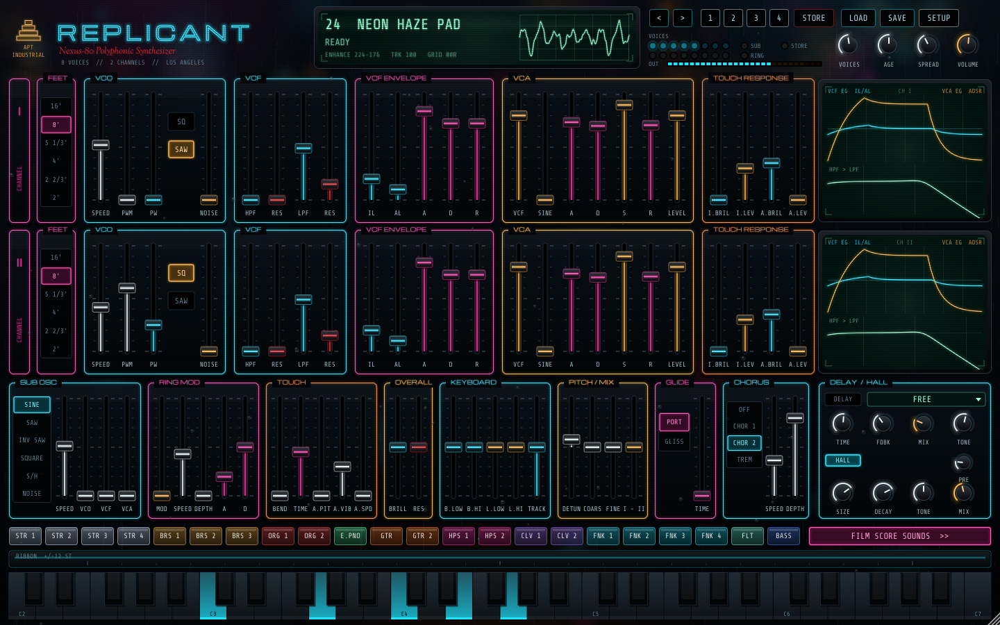

# REPLICANT — Nexus-80

A non-commercial tribute to the **Yamaha CS-80** (1977): the eight-voice, dual-layer
polysynth behind so many late-70s and early-80s film scores. It's a VST3 instrument for
FL Studio, behind an ESPER-machine CRT and a rain-streaked neon panel.
Made by **APT Industrial**.



## The voice (modelled on the CS-80)

Every one of the 8 voices (up to 16) is **two complete synths in parallel**,
Channel I and Channel II, exactly like the original:

| Section | What it does |
|---|---|
| **FEET** | 16', 8', 5 1/3', 4', 2 2/3', 2' per channel. |
| **VCO** | Sawtooth core with the CS-80's wave-shape converter: SAW and SQUARE tabs (both at once if you like), pulse width 50–90 %, PWM with its own LFO per channel, white NOISE. polyBLEP anti-aliasing at 2x oversampling. |
| **VCF** | 12 dB/oct high-pass **then** 12 dB/oct low-pass, each with resonance. Zero-delay-feedback filters with OTA-style saturation; they peak hard but stop short of self-oscillation, like the original. |
| **VCF envelope** | The CS-80's **IL / AL / A / D / R**. It starts IL *below* the cutoff sliders, rises to AL *above* them, decays back to the slider position and releases back down to IL. It sweeps the HPF and LPF together, which gives you the brass "blat", plucks and swells. |
| **VCA** | VCF LEVEL plus the unfiltered **SINE** mixed in at the VCA, ADSR, LEVEL. |
| **Touch response** | Per channel: initial (velocity) and after (aftertouch) control of brilliance and level. |
| **Sub oscillator** | The global LFO: sine, saw, inverted saw, square, S/H, noise. It reaches audio rate and feeds VCO, VCF and VCA. |
| **Ring modulator** | One for the instrument, with its own attack/decay envelope that sweeps the ring speed and retriggers on every key. |
| **Touch (performance)** | Velocity-driven initial pitch bend (notes slide up into pitch), aftertouch to pitch, to vibrato depth and to sub osc speed. |
| **Overall / Keyboard** | Global brilliance and resonance; keyboard control of brilliance and level, separately for the low and high halves; filter tracking. |
| **Pitch / Mix / Glide** | Channel II detune, coarse, fine, I/II balance. Polyphonic **portamento or glissando**: each voice glides from its own last note. |
| **Ribbon** | Touch anywhere and slide to bend every sounding note; it springs back when you let go. It's an automatable parameter, so you can draw ribbon moves in FL Studio. |
| **Chorus / Tremolo** | Chorus 1 (two BBD lines in anti-phase), Chorus 2 (three-phase ensemble), stereo tremolo. |
| **Delay / Hall** | Additions for the film-score sound: tempo-syncable ping-pong delay, and a modulated 8-line FDN hall with decay up to 20 s. |
| **Analog** | Every voice has its own pitch, cutoff, envelope-speed and level tolerances, plus slow independent drift (the AGE knob). |

**Expression:** polyphonic aftertouch, channel aftertouch, mod wheel (vibrato / pressure /
brilliance, in SETUP), pitch wheel, sustain pedal and **MPE** (per-note bend and pressure).

**Sounds:** the 22 tone-selector voices of the CS-80 (the coloured buttons), 20 new sounds
in the film-score style (FILM SCORE SOUNDS), 4 memories saved with your project
(STORE, then 1–4), and sound files (.rpl).

## Building

Windows builds run automatically on GitHub Actions (`.github/workflows/build-windows.yml`).
Push to `main`, then download **Replicant-Windows** from the run's page on the Actions tab.

To build locally (any platform, CMake ≥ 3.22):

```
cmake -S . -B build -DCMAKE_BUILD_TYPE=Release
cmake --build build --config Release --target Replicant_VST3
```

JUCE 8.0.9 is downloaded automatically, or pass `-DJUCE_DIR=/path/to/JUCE`.
`-DREP_BUILD_TESTS=ON` adds `RepRenderTest` (renders every preset plus expression, torture,
CPU and state tests to WAV) and `RepUiSnapshot` (renders the editor to PNG).

See `INSTALL.txt` for installing in FL Studio.

## Credits

Fonts: Michroma, Share Tech Mono and Sorts Mill Goudy, all under the SIL Open Font License.

Replicant is a non-commercial tribute. Yamaha and CS-80 are trademarks of their respective
owners; this project is not affiliated with or endorsed by them.
